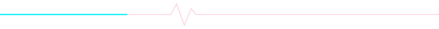

<!-- Hi, source reader. Nice. Wake up, Samurai — there are code reviews to burn. -->

<div align="center">



<br/>


</div>



### `> whoami`

```console
felps@night-city:~$ whoami
Filipi — "felps"

felps@night-city:~$ cat profile.txt
role     : Computer Science student, 2nd semester @ IDP
internship: TCDF (Tribunal de Contas do Distrito Federal)
stack    : Python, C++
status   : open to new opportunities
```

I'm **Filipi**, but most people call me **Felps**. I'm a Computer Science student at **IDP** in Brasília and an intern at **TCDF**. I like low-level work, clear code and learning things properly, from how memory is laid out to how a system fits together.

- 🔭 **Working with** Python and C++
- 🌱 **Learning** backend development, SQL and software design
- 📍 **Based in** Brasília, Brazil
- 🗣️ **Languages** Portuguese (native), English (fluent)
- 📫 **Open to** internships, junior roles and collaborations

---

### `> stack --list`

**Core**


**Also used**


**Tools**


---

### `> ls ./projects`

My projects will live in a single repository while I build it out:

<a href="https://github.com/Felps-26/projetos">
  
</a>

> 🚧 **`projetos`** is being populated. Check back soon.

<!-- Research: two papers are in progress. Add a "Research" section here when they are ready to be public. -->

---

### `> connect --direct`

<div align="center">

<a href="https://www.linkedin.com/in/filipi-ramos/">
  
</a>
<a href="https://instagram.com/filipi.rmz_">
  
</a>

<br/><br/>


<sub><i>Build things that outlast the hype.</i></sub>

</div>